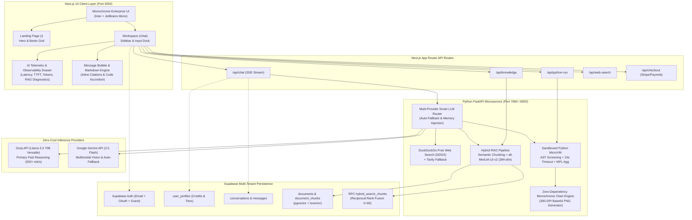

# FetoAI — Unified Intelligence for Research, Code & Data

[](https://opensource.org/licenses/MIT)
[-000000.svg)](https://nextjs.org)
[](https://fastapi.tiangolo.com)
[](https://www.typescriptlang.org)
[](https://tailwindcss.com)
[](https://supabase.com)
[](#environment--100-free-tier-setup)

**FetoAI** is a commercial-grade, multi-tenant AI SaaS web application engineered with a strictly minimalist monochrome enterprise aesthetic (`#000000`, `#FFFFFF`, neutral grays). It provides an all-in-one workspace unifying **multi-provider smart routing**, **zero-cost live web search**, **dense + sparse hybrid document RAG**, an **isolated Python microVM code interpreter with 300-DPI monochrome charting**, and a comprehensive **AI Telemetry & Observability slide-over drawer**.

---

## ✦ System Architecture



---

## ✦ Core Capabilities

### 1. AI Telemetry & Observability Drawer
- **Real-Time Latency & TTFT Tracking**: Measures end-to-end response latency (ms) and Time-to-First-Token (TTFT) with an interactive latency distribution bar.
- **Provider & Model Transparency**: Discloses active provider (`Groq LPU`, `Google Gemini`, or `FetoAI Local LPU`), model ID (`llama-3.3-70b-versatile`, `gemini-2.5-flash`), throughput rate (`tok/s`), and free-tier cost estimation (`$0.000000`).
- **Token Breakdown**: Visualizes prompt tokens, completion tokens, and total context usage against the 128k model window.
- **RAG Retrieval Diagnostics**: Displays all retrieved chunks with their:
  - Dense **Cosine Similarity** (`<=>` on 384-dim embeddings)
  - Sparse **Keyword Rank** (`ts_rank` on full-text index)
  - Combined **Reciprocal Rank Fusion (RRF)** score ($k=60$)
  - Verified content excerpt and source page badge
- **Interactive Triggers**: Click the top header latency badge or the **Metrics** pill under any assistant message to open that specific turn's telemetry.
- **Export Capabilities**: One-click **'Export Telemetry JSON'** and clipboard copying.

### 2. Sandboxed Python Code Interpreter (Zero Cloud Sandbox Fees)
- **Security-Hardened AST Screening**: Static code screening blocks dangerous modules (`subprocess`, `shutil`, `ctypes`, `socket`, `pty`, `commands`) and blocked operations (`os.system`, `os.popen`, `os.remove`, `os.kill`) before execution.
- **Process & Resource Isolation**: Runs in isolated temporary workspaces with a strict 15-second subprocess execution timeout.
- **Strict Monochrome Charting**: Automatically enforces pure black (`#000000`), crisp white (`#FFFFFF`), and neutral gray (`#E5E5E5`) styling in Matplotlib with headless `Agg` mode.
- **Resilient Fallback Generators**: Pure-Python (`chart_generator.py`) and pure-Node (`chartGenerator.ts`) binary PNG generators produce 300-DPI monochrome charts even without external plotting dependencies.
- **Workspace UI**: Renders charts in a crisp bordered monochrome card with a **Download PNG** button, alongside a collapsible **View Executed Python Code & Console Output** accordion with tabbed console logs and source code.

### 3. Hybrid Document RAG with Local Embeddings
- **Zero-Cost Embeddings**: Generates 384-dimensional embeddings locally using `sentence-transformers` (`all-MiniLM-L6-v2`) with zero OpenAI/Voyage API costs.
- **Recursive Semantic Chunking**: Smart text chunking (`chunk_size=800`, `chunk_overlap=150`) across PDF, DOCX, TXT, and Markdown files.
- **Reciprocal Rank Fusion (RRF)**: Supabase PostgreSQL RPC function `hybrid_search_chunks` balances semantic cosine similarity and BM25 full-text keyword ranking.
- **Grounded Verification Popover**: Generates clickable `[File Name - Page X]` badges in assistant replies that open a modal preview displaying the exact source excerpt.

### 4. Zero-Cost Live Web Search
- **DuckDuckGo Integration**: Uses `duckduckgo-search` (`DDGS`) for unlimited zero-cost real-time search, with automatic Tavily API fallback if a key is provided.
- **Clickable Inline Citations**: Formats sources into inline `[1]`, `[2]` badges linked to verified URLs.
- **Sources Card Strip**: Renders a horizontal monochrome source strip above assistant answers displaying domain, title, and excerpt.

### 5. Multi-Tenant Auth & SaaS Monetization
- **Supabase Multi-Tenant Schema**: Complete SQL migration in `supabase/schema.sql` supporting `user_profiles`, `conversations`, `messages`, `documents`, `document_chunks`, and `user_memory`.
- **Daily Credit Rate Limiting**: Free-tier rate limiting (15 daily credits) with atomic credit deduction RPC (`deduct_user_credit`).
- **Monochrome Modals**: Built-in Sign In / Sign Up modal, Guest Mode (5 free messages), and an 'Upgrade to Pro' modal with ready-to-wire Stripe / Paymob checkout endpoints.

---

## ✦ Environment & 100% Free-Tier Setup

FetoAI is designed to run seamlessly out of the box. If API keys are omitted, FetoAI automatically falls back to clean, deterministic demo streams and native monochrome chart generators so it **never crashes**.

### Configuration Files
- `.env.example`: Root template
- `.env.local`: Next.js frontend environment
- `backend/.env`: Python FastAPI backend environment

```env
# ==============================================================================
# FetoAI Environment Configuration
# ==============================================================================

# Fast Text Reasoning (Free Tier: 30 RPM / 14,400 RPD)
# Get your free key at: https://console.groq.com/keys
GROQ_API_KEY=

# Multimodal Vision & Fallback (Free Tier: 15 RPM / 1,500 RPD)
# Get your free key at: https://aistudio.google.com/app/apikey
GEMINI_API_KEY=

# Multi-Tenant Auth, Database & Vector Storage (Free Tier)
# Get your free project at: https://supabase.com
NEXT_PUBLIC_SUPABASE_URL=
NEXT_PUBLIC_SUPABASE_ANON_KEY=
SUPABASE_SERVICE_ROLE_KEY=

# Optional Web Search Upgrade (Default: Free DuckDuckGo DDGS)
# Get free key at: https://tavily.com
TAVILY_API_KEY=

# Backend Microservice Routing URL
NEXT_PUBLIC_BACKEND_URL=http://localhost:8000

# Demo Mode Toggle (Forces resilient offline demo responses if keys are omitted)
FETOAI_DEMO_MODE=true
```

---

## ✦ Production Deployment Guide (100% Free Tier)

### 1. Frontend Deployment on Vercel (Free Tier)

1. **Push your repository** to GitHub.
2. Log in to [Vercel](https://vercel.com) and click **"Add New Project"**.
3. Import your `FetoAI` GitHub repository.
4. Configure the Project Settings:
   - **Framework Preset**: `Next.js`
   - **Root Directory**: `./`
   - **Build Command**: `npm run build`
   - **Output Directory**: `.next`
5. Add the Environment Variables:
   - `NEXT_PUBLIC_SUPABASE_URL`
   - `NEXT_PUBLIC_SUPABASE_ANON_KEY`
   - `NEXT_PUBLIC_BACKEND_URL` (URL of your deployed FastAPI backend)
   - `GROQ_API_KEY`
   - `GEMINI_API_KEY`
   - `TAVILY_API_KEY` (optional)
6. Click **Deploy**. Vercel will build and provision your global Edge frontend.

---

### 2. Backend Deployment on Hugging Face Spaces (Docker SDK - 100% Free 16GB RAM)

Hugging Face Spaces provides a completely free containerized environment with **2 vCPUs and 16GB RAM**, ideal for running Python FastAPI with `sentence-transformers` and the sandboxed code interpreter.

1. Create a free account at [huggingface.co](https://huggingface.co).
2. Click on your profile -> **"New Space"**.
3. Configure the Space:
   - **Space Name**: `fetoai-backend`
   - **License**: `MIT`
   - **Space SDK**: Choose **`Docker`** -> **`Blank`**
   - **Space Hardware**: Free CPU (2 vCPU, 16GB RAM)
4. Clone the Space repository locally or push your `backend/` directory directly:
   ```bash
   git remote add space https://huggingface.co/spaces/<your-username>/fetoai-backend
   git subtree push --prefix backend space main
   ```
   *(The included `backend/Dockerfile` is pre-configured with UID 1000 and port 7860 specifically for Hugging Face Spaces).*
5. In your Space settings, go to **"Variables and secrets"** and add:
   - `GROQ_API_KEY`
   - `GEMINI_API_KEY`
   - `SUPABASE_URL`
   - `SUPABASE_SERVICE_ROLE_KEY`
   - `TAVILY_API_KEY` (optional)
6. Your backend will build and run at:
   `https://<your-username>-fetoai-backend.hf.space`
7. Update `NEXT_PUBLIC_BACKEND_URL` in your Vercel deployment with this URL.

---

### 3. Backend Deployment on Render (Alternative Free Web Service)

1. Create a free account at [render.com](https://render.com).
2. Click **"New +"** -> **"Web Service"**.
3. Connect your GitHub repository.
4. Configure service settings:
   - **Name**: `fetoai-backend`
   - **Root Directory**: `backend`
   - **Language**: `Docker` (Render automatically uses `backend/Dockerfile`)
   - **Instance Type**: `Free`
5. Add Environment Variables in the Render dashboard:
   - `PORT`: `8000`
   - `GROQ_API_KEY`: `<your-groq-key>`
   - `GEMINI_API_KEY`: `<your-gemini-key>`
   - `SUPABASE_URL`: `<your-supabase-url>`
   - `SUPABASE_SERVICE_ROLE_KEY`: `<your-service-key>`
6. Click **"Create Web Service"**. Render will deploy the container with automatic SSL.

---

### 4. Supabase Database & pgvector Setup

1. Create a free project at [supabase.com](https://supabase.com).
2. Navigate to the **SQL Editor** tab in your Supabase dashboard.
3. Open [`supabase/schema.sql`](supabase/schema.sql) in this repository, copy its full content, paste it into the SQL Editor, and click **Run**.
4. This script automatically:
   - Enables `pgvector` extension.
   - Creates `user_profiles` with auto-trigger on user signup.
   - Sets up `conversations`, `messages`, `documents`, and `document_chunks`.
   - Creates the `hybrid_search_chunks` RPC function with Reciprocal Rank Fusion.
   - Configures the `deduct_user_credit` rate limiting RPC.

---

## ✦ Local Development

### Prerequisites
- Node.js 18.18+ or Node.js 20+
- Python 3.10+ (for backend microservice)
- Git

### 1. Frontend Setup
```bash
# Clone the repository
git clone https://github.com/your-username/Feto-AI.git
cd Feto-AI

# Install frontend dependencies
npm install

# Start Next.js development server
npm run dev
```
Open [http://localhost:3000](http://localhost:3000) in your browser.

### 2. Python Backend Setup
```bash
# In a new terminal window
cd backend

# Create virtual environment
python -m venv venv
# On Windows:
.\venv\Scripts\activate
# On Linux/macOS:
source venv/bin/activate

# Install dependencies
pip install -r requirements.txt

# Run FastAPI backend
python main.py
```
FastAPI server will start on [http://localhost:8000](http://localhost:8000). Interactive Swagger documentation is available at [http://localhost:8000/docs](http://localhost:8000/docs).

### 3. Production Verification Build
```bash
# Test Next.js production compilation
npm run build

# Run sandbox pipeline verification test
node scratch/test_sandbox_pipeline.mjs
```

---

## ✦ Project Structure

```
Feto-AI/
├── .env.example                     # Root environment variable template
├── .env.local                       # Next.js local environment variables
├── package.json                     # Frontend dependencies & scripts
├── tailwind.config.ts               # Monochrome design system configuration
├── tsconfig.json                    # Strict TypeScript configuration
├── supabase/
│   └── schema.sql                   # Supabase SQL schema, pgvector & RRF RPC
├── backend/
│   ├── Dockerfile                   # 1-click Docker deployment (HF Spaces / Render)
│   ├── .dockerignore                # Container build exclusions
│   ├── requirements.txt             # Python backend dependencies
│   ├── main.py                      # FastAPI microservice entrypoint
│   └── app/
│       ├── config.py                # Pydantic backend settings
│       ├── main.py                  # FastAPI application & CORS setup
│       ├── api/
│       │   └── routes.py            # Endpoints: /chat/stream, /execute-python, /documents/upload
│       ├── router/
│       │   └── llm_router.py        # Smart Multi-Provider Router & SSE Streamer
│       └── services/
│           ├── sandbox_service.py   # AST-Screened Python MicroVM & MPL Styler
│           ├── chart_generator.py   # Pure-Python 300-DPI PNG Generator
│           ├── document_service.py  # Recursive Semantic Document Chunking
│           ├── embedding_service.py # sentence-transformers 384-dim Embedder
│           ├── search_service.py    # DuckDuckGo DDGS & Tavily Web Searcher
│           └── supabase_service.py  # Supabase RPC Client & Credit Enforcer
└── src/
    ├── app/
    │   ├── layout.tsx               # Root layout & theme script provider
    │   ├── globals.css              # Monochrome theme CSS variables
    │   ├── page.tsx                 # High-converting Landing Page
    │   ├── chat/
    │   │   └── page.tsx             # Interactive Workspace & SSE consumer
    │   └── api/
    │       ├── chat/route.ts        # SSE streaming route with telemetry
    │       ├── python-run/route.ts  # Isolated code interpreter endpoint
    │       ├── knowledge/route.ts   # Document upload & chunking route
    │       ├── web-search/route.ts  # DuckDuckGo search API route
    │       └── checkout/route.ts    # SaaS checkout stub (Stripe/Paymob)
    ├── components/
    │   ├── brand/
    │   │   └── FetoLogo.tsx         # Minimalist vector crystal logo
    │   ├── landing/
    │   │   ├── Navbar.tsx           # Landing navigation bar
    │   │   ├── Hero.tsx             # Hero section with interactive prompt dock
    │   │   ├── BentoGrid.tsx        # 4-engine capability Bento grid
    │   │   ├── Pricing.tsx          # Free vs Pro pricing table
    │   │   └── Footer.tsx           # Monochrome footer with status
    │   ├── theme/
    │   │   ├── ThemeProvider.tsx    # NextThemes dark/light wrapper
    │   │   └── ThemeToggle.tsx      # Top bar theme switcher
    │   └── workspace/
    │       ├── Header.tsx           # Model selector & telemetry toggle
    │       ├── Sidebar.tsx          # Collapsible history, credits & tabs
    │       ├── InputDock.tsx        # Auto-expanding prompt dock & pills
    │       ├── MessageBubble.tsx    # Markdown, citations & code accordion
    │       ├── TelemetryDrawer.tsx  # Right slide-over observability drawer
    │       ├── KnowledgeBaseModal.tsx# RAG document management modal
    │       ├── SettingsModal.tsx    # API keys & System Memory modal
    │       └── ProModal.tsx         # SaaS upgrade trigger modal
    └── lib/
        ├── types.ts                 # Full TypeScript interfaces & types
        ├── utils.ts                 # Formatting & class merging helpers
        ├── chartGenerator.ts        # Pure-Node.js 300-DPI PNG chart generator
        ├── supabaseClient.ts        # Browser Supabase client
        ├── supabaseAdmin.ts         # Server Supabase admin client
        ├── llmService.ts            # Frontend mock & fallback generators
        └── mockData.ts              # Default models, sessions & metrics
```

---

## ✦ License

Distributed under the MIT License. See `LICENSE` for more information.
